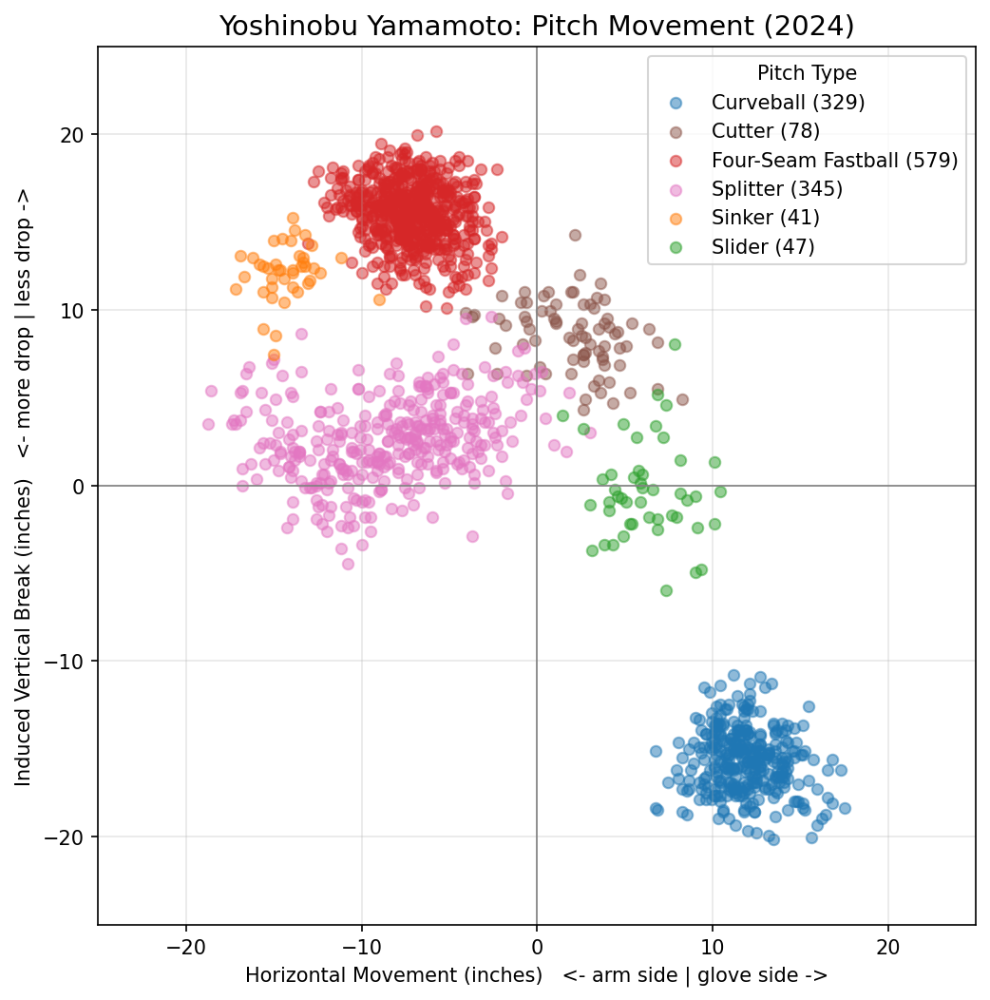

# Dodgers Pitch Arsenal Classifier

**Can a machine learning model tell what pitch was thrown using only the physics of the ball in flight?**

A hitter has about 400 milliseconds to read a pitch from its speed, spin, and movement. This project asks whether a model can make the same read. It was trained on every pitch thrown in 2024 by three Los Angeles Dodgers starters.

<p align="center">
  
</p>

<p align="center"><em>Every pitch Yoshinobu Yamamoto threw in 2024, plotted by how much its spin moved it sideways (horizontal axis) and up or down compared with a ball thrown with no spin (vertical axis). Each pitch type forms its own cluster. His curveball (bottom right) sits far from everything else. This separation is what the model learns from.</em></p>

---

## Headline Finding

**Yes. Physics alone is enough.** A Random Forest classifier labeled **98.6%** of held-out pitches correctly (1,062 of 1,077). It used nothing but release, spin, and movement measurements.

The 15 mistakes landed in the places that also fool hitters:

| Actual pitch | Predicted as | Misses |
|---|---|---|
| Sinker | Four-Seam Fastball | 5 |
| Cutter | Four-Seam Fastball | 5 |
| Curveball | Slider | 3 |
| Four-Seam Fastball | Sinker | 1 |
| Slider | Curveball | 1 |

**Fastballs (11 of 15 misses).** Four-seamers, sinkers, and cutters are all thrown hard and differ mainly in a few inches of late movement. A sinker or cutter that doesn't move much looks just like a four-seamer. The cutter was the hardest pitch for the model: it caught only 87% of them, and the cutter is also the rarest pitch in the data.

**Breaking balls (4 of 15 misses).** Curveballs and sliders both spin hard and break toward the glove side, so a tight curveball can pass for a slider.

The model never confused a changeup or a splitter with anything else. Both are much slower than the fastballs. When two pitches look alike physically, the model hesitates in the same places a batter would.

The features the model relied on most:

1. **Release speed**: 25% of importance
2. **Vertical movement** (`pfx_z`): 21%
3. **Horizontal movement** (`pfx_x`): 18%

These match what the exploration plots showed before any model was built: speed and vertical movement separate pitch types better than any other single features.

---

## The Data

- **Source:** MLB Statcast pitch-by-pitch data, pulled with [`pybaseball`](https://github.com/jldbc/pybaseball)
- **Pitchers:** Yoshinobu Yamamoto, Tyler Glasnow, Gavin Stone
- **Season:** 2024 regular season (March 30 – October 1)
- **Size:** 5,439 pitches pulled, 5,384 kept after cleaning

| Pitch | Code | Count |
|---|---|---|
| Four-Seam Fastball | FF | 1,959 |
| Slider | SL | 869 |
| Curveball | CU | 775 |
| Sinker | SI | 673 |
| Changeup | CH | 574 |
| Splitter | FS | 345 |
| Cutter | FC | 189 |

**Cleaning steps**

- Removed pitches with no recorded pitch type.
- Removed sweepers (ST). They were too rare for the model to learn reliably. (Together with the step above, this removed 46 pitches.)
- Removed 9 pitches that were missing a physical measurement such as spin rate, spin axis, or arm angle.
- Dropped `effective_speed`. It is almost identical to `release_speed` (correlation 0.99), so it added nothing new.
- Kept only *physical* columns as model inputs. Outcome columns such as swing result, exit velocity, and launch angle were set aside. A hitter doesn't know the outcome before deciding to swing, so the model shouldn't either.

---

## Approach

1. **Explore** ([01_exploration.ipynb](01_exploration.ipynb)): pull the data, clean it, separate physical features from outcomes, plot each feature's distribution by pitch type, and save the cleaned data to `data/pitches_clean.csv`.
2. **Model** ([02_modeling.ipynb](02_modeling.ipynb)): train a Random Forest (100 trees) on 10 physical features, using an 80/20 train/test split stratified by pitch type, and evaluate it with a confusion matrix, accuracy, and per-pitch precision and recall.
3. **Visualize** ([03_visualizations.ipynb](03_visualizations.ipynb)): build horizontal-vs-vertical movement plots for each pitcher, plus a closer look at one standout pitch.

A single decision tree is easy to read but easy to fool. A Random Forest builds a hundred of them, each on a different random sample of the data, and takes a majority vote. It doesn’t need the features put on the same scale, it picks up on combinations like "fast and dropping less than expected," and it tells you afterward which features it leaned on most.

---

## Standout Pitch

Out of the hand, Yamamoto's splitter looks like a fastball. It travels the same lane — both pitches move about 7–8 inches to the arm side — and arrives only 5 mph slower. The difference is spin: the splitter generates 1,324 rpm compared with 2,156 rpm on the four-seamer. Without that backspin to hold the ball up, it ends up roughly 13 inches lower than the fastball a hitter thought they were reading. On the movement plot, that's the pink cluster sitting directly below the red one — same horizontal lane, dramatically different drop. The model had no trouble separating them. Not a single splitter was misclassified. Hitters don't get that luxury.

---

## Caveats: Reading the 98.6% Honestly

- **The model can partly tell who is pitching.** Release position and arm angle are distinctive for each pitcher. That makes "which pitch?" easier than it would be for an unknown pitcher.
- **The labels come from an algorithm.** Statcast assigns pitch types with its own classifier, which uses similar physical measurements. Part of what this model learns is how to reproduce that classifier.
- **Three pitchers is a small world.** Results may not hold across the whole league.

A tougher test for future work: train on two pitchers and test on the third.

---

## Repository Structure

```
Summer-Project/
├── README.md                 ← you are here
├── 01_exploration.ipynb      ← data pull, cleaning, feature distributions
├── 02_modeling.ipynb         ← Random Forest + confusion matrix
├── 03_visualizations.ipynb   ← movement plots + narrative
├── images/                   ← exported figures used in this README
├── requirements.txt
└── data/                     ← pitches_clean.csv, created by notebook 01 (not committed; see .gitignore)
```

## Reproduce It

```bash
git clone https://github.com/AsherRingUTK/Pitch-Classifier.git
cd Pitch-Classifier
python -m venv venv
venv\Scripts\activate          # macOS/Linux: source venv/bin/activate
pip install -r requirements.txt
```

Then run the notebooks in order (01 → 02 → 03). Notebook 01 downloads the data from Statcast, which needs an internet connection, and saves the cleaned version to `data/pitches_clean.csv`. Notebooks 02 and 03 load that file.

---

## Tools

Python · pandas · scikit-learn · matplotlib · seaborn · pybaseball · Jupyter
